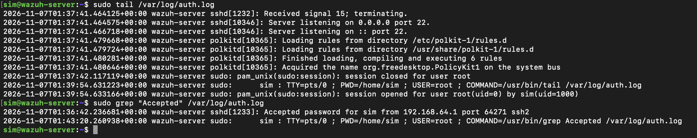
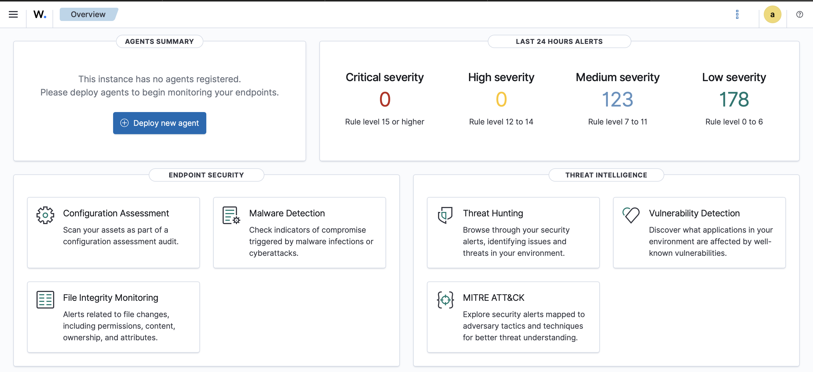
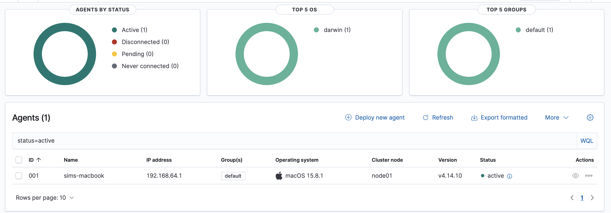
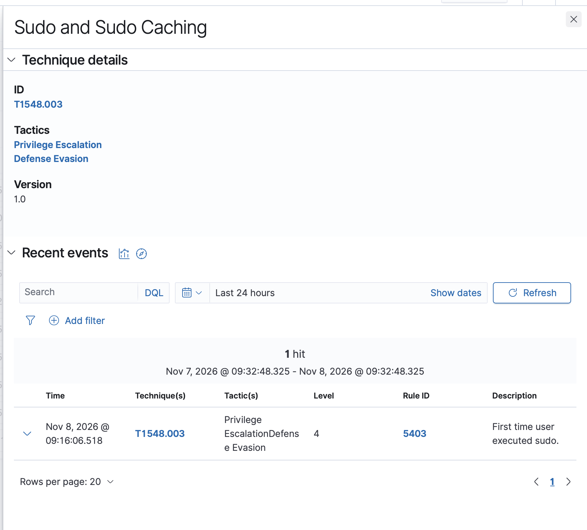
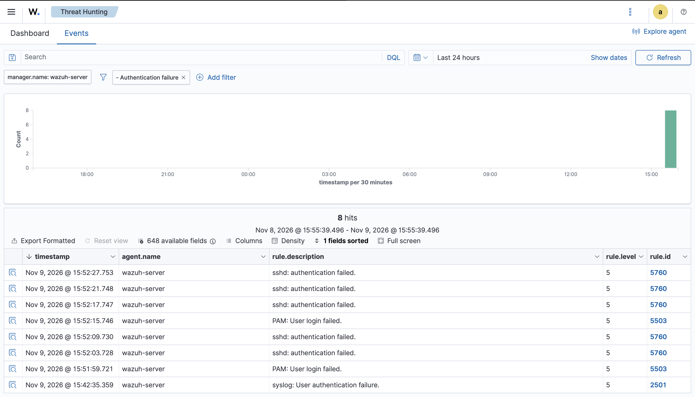
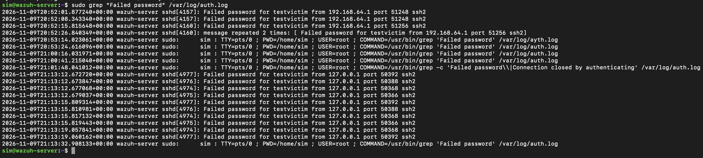
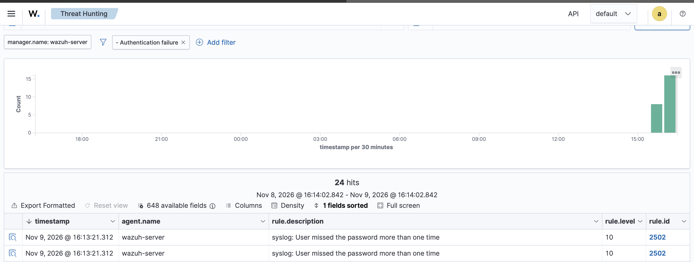
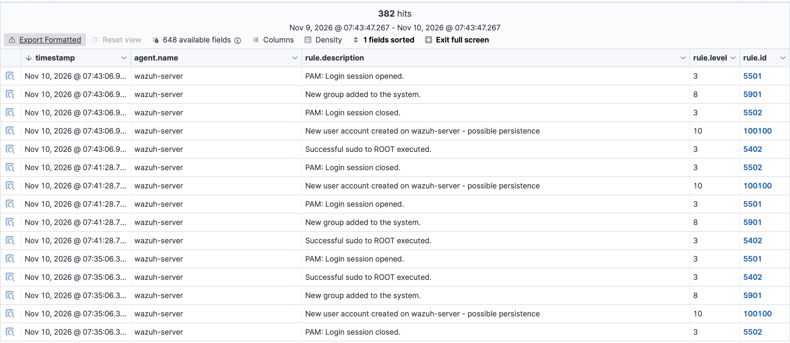
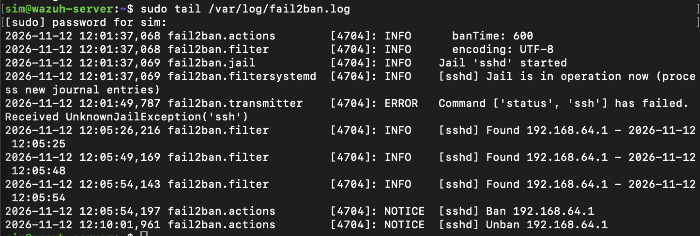

# Home SOC Lab — Wazuh SIEM

A hands-on Security Operations Center lab built from scratch: a Wazuh SIEM
deployed on an Ubuntu server, monitoring a live macOS endpoint, used to
simulate and detect real attack techniques — including a custom detection rule
I authored and mapped to MITRE ATT&CK.

> **Disclaimer:** All attacks in this project were performed against my own
> isolated lab systems on a private network, for training and
> detection-testing purposes only.

---

## Overview

I built this lab to learn SOC analyst fundamentals the way they're actually
practiced: collecting logs, detecting attacks, triaging alerts, writing custom
detection rules, and documenting incidents. Everything runs on a single
MacBook Air (M2, 8 GB) using virtualization.

**What I did:**
- Deployed a full Wazuh SIEM stack (indexer, manager, dashboard)
- Connected a macOS endpoint as a monitored agent
- Triaged alerts and mapped them to MITRE ATT&CK
- Simulated an SSH brute-force attack and detected it via log correlation
- Wrote a **custom detection rule** for account-creation persistence
- Documented findings as professional incident reports

---

## Architecture

```
  MacBook Air (M2)
  ┌─────────────────────────────────────────┐
  │                                          │
  │   macOS endpoint ──(Wazuh agent)──┐      │
  │                                   │      │
  │   UTM Virtual Machine             │      │
  │   ┌───────────────────────────┐   │      │
  │   │  Ubuntu 24.04 Server      │◄──┘      │
  │   │  ┌─────────────────────┐  │          │
  │   │  │ Wazuh Indexer       │  │          │
  │   │  │ Wazuh Manager       │  │          │
  │   │  │ Wazuh Dashboard     │  │          │
  │   │  └─────────────────────┘  │          │
  │   └───────────────────────────┘          │
  └─────────────────────────────────────────┘
```

---

## Tools & Technologies

| Category | Tools |
|---|---|
| SIEM | Wazuh (indexer, manager, dashboard) |
| OS | Ubuntu Server 24.04, macOS |
| Virtualization | UTM (Apple Silicon) |
| Attack simulation | Hydra, SSH |
| Frameworks | MITRE ATT&CK |
| Skills | Linux administration, log analysis, SSH, detection engineering |

---

## Phase 1 — Build the SIEM

Deployed Ubuntu Server 24.04 in a VM and installed the full Wazuh stack
(indexer, manager, dashboard). Hardened the server, enabled SSH, and verified
log collection directly from the command line before relying on the dashboard —
confirming a successful login and the SSH service lifecycle in `auth.log`.



With the stack running, the Wazuh dashboard came online and immediately began
generating alerts from the server monitoring itself.



---

## Phase 2 — Connect & Monitor an Endpoint

Deployed the Wazuh agent to the macOS host. The agent registered as **Active**,
and Wazuh automatically detected the OS, ran a vulnerability scan, and performed
a CIS benchmark configuration assessment against the endpoint.



**Alert triage.** To practice reading alerts, I generated a privileged action
on the endpoint and traced it in the SIEM. Wazuh classified it as
**T1548.003 (Sudo and Sudo Caching)** under the Privilege Escalation and
Defense Evasion tactics — a low-severity, expected event in this case, correctly
triaged as benign.



---

## Phase 3 — Simulate & Detect a Brute-Force Attack

Used Hydra to run an SSH brute-force against a test account.

**Step 1 — individual failures.** Each failed login was logged on its own at
level 5, across three layers (sshd 5760, PAM 5503, syslog 2501).



**Step 2 — raw evidence.** The failures are visible directly in `auth.log`,
showing two attack sources clustered within seconds.



**Step 3 — correlated detection.** Once enough failures landed inside a short
time window, the SIEM correlated them into a single **level 10 brute-force
alert** (rule 2502), mapped to **MITRE T1110**.



**Key finding:** slow, manual attempts stayed at level 5 — they were too spread
out to cross the correlation threshold. Only the dense, automated burst
triggered the high-severity alert. Detection depends on both volume *and*
timing.

---

## Phase 4 — Detection Engineering: a Custom Rule

Authored a custom Wazuh rule (ID 100100) that detects local account creation —
a common persistence technique — and raises it to level 10 with an explicit
MITRE **T1136.001** mapping, so unauthorized accounts surface above routine
events.

```xml
<group name="local,syslog,">
  <rule id="100100" level="10">
    <if_sid>5902</if_sid>
    <description>New user account created - possible persistence</description>
    <mitre>
      <id>T1136.001</id>
    </mitre>
  </rule>
</group>
```

The rule fired on the next account creation, standing out at level 10 above the
built-in events (new group, sudo to root).



---


## Phase 5 — Automated Response with fail2ban

Detection is only half the job — this phase adds automated **response**.
I deployed fail2ban to watch the SSH authentication log and automatically
ban any IP that exceeds a failure threshold (3 failures in 5 minutes),
blocking it at the firewall for 10 minutes.

I verified it by running a brute-force against my own server: after three
failed attempts, fail2ban banned the source IP automatically — which even
dropped my active SSH session, a firsthand lesson in why automated response
must whitelist trusted IPs (the `ignoreip` setting). The ban auto-expired
exactly 10 minutes later, matching the configured bantime.



**What this adds:** the lab now detects attacks (Wazuh SIEM) *and* responds
to them automatically (fail2ban) — the core idea behind SOAR (Security
Orchestration, Automation, and Response).

## Incident Reports

Professional write-ups of both detections — summary, timeline, indicators
(IOCs), MITRE mapping, analysis, and recommended response — are in
[`incident-reports.md`](incident-reports.md).

---

## Skills Demonstrated

- SIEM deployment and operation (Wazuh)
- Linux server administration (LVM, swap, systemd, package management)
- Log analysis and alert triage
- MITRE ATT&CK mapping
- Attack simulation (Hydra, SSH brute force)
- **Detection engineering** (custom rules)
- Incident documentation
- Troubleshooting (diagnosed and fixed a failed install from logs)

---

## Challenges Solved

- **Wrong OS version:** installed Ubuntu 26.04 before learning Wazuh supports
  up to 24.04 — rebuilt on the supported version. Lesson: verify compatibility
  first.
- **Failed install (full disk):** read the install log, found the disk was out
  of space, confirmed with `df -h`, and extended the LVM volume live — no
  reinstall required.
- **Alert not firing:** learned that brute-force correlation needs failures
  packed into a short time window; switched from a slow loop to Hydra to cross
  the threshold.
- **Resource tuning:** adapted a full SIEM stack to an 8 GB host with swap and
  reduced indexer memory.

---

*Built by Simeon Todd (github.com/codinwithsim) as a self-directed project to
develop SOC analyst skills.*
